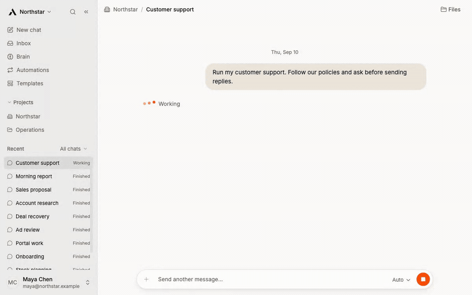
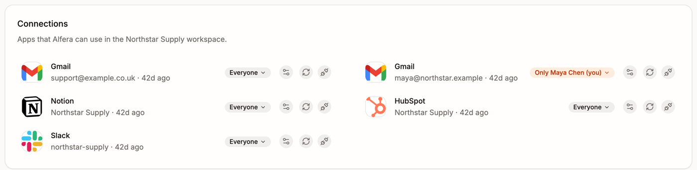
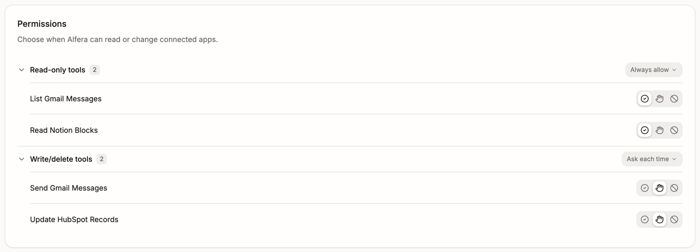

<p align="center">
  
</p>

<h1 align="center">company-use</h1>

<h3 align="center">The open-source AI coworker your whole team shares.</h3>

<p align="center">
  It works in your apps, starts work by itself, and asks before anything you care about.<br>
  Any model. On your own server, or on Alfera Cloud.
</p>

<p align="center">
  <a href="SELF_HOSTING.md"></a>
  <a href="https://app.alfera.ai/sign-up?from=github"></a>
  <a href="LICENSE"></a>
  <a href="https://alfera.ai"></a>
  <a href="https://github.com/alfera-labs/company-use/releases/latest"></a>
  <a href="CONTRIBUTING.md"></a>
</p>

<p align="center">
  <a href="https://alfera.ai"><b>Website</b></a> ·
  <a href="SELF_HOSTING.md"><b>Documentation</b></a> ·
  <a href="https://app.alfera.ai/sign-up?from=github"><b>Cloud</b></a> ·
  <a href="https://github.com/alfera-labs/company-use/releases/latest"><b>Mac app</b></a> ·
  <a href="#quick-start"><b>Self-host</b></a>
</p>

<p align="center">
  
</p>

| **Multiplayer** | **One coworker for the whole team, many tasks at once. Shared connections and personal ones.** |
| :--- | :--- |
| **Permissions** | Per connection and per action: allow, ask first, or never. |
| **Starts by itself** | On a schedule, from a webhook, or when something happens in Gmail, HubSpot, Stripe and 600+ other app events. |
| **Its own computer** | Every chat runs in a sandbox with a terminal, and its files stay from one chat to the next. |
| **Where your team is** | The web app, Slack, email and a Mac app. |
| **Any model** | Claude, GPT, Gemini, Kimi, DeepSeek, Qwen, GLM, Mistral, OpenRouter, your ChatGPT plan, or a model you run yourself. |
| **Templates** | 38 ready-made jobs for sales, finance, support and operations. |

## Quick start

**One click, no terminal.** The page makes a server in your own cloud account. It sets itself up
in about 10 minutes, for about $24 a month billed by your cloud, not by us.

<p>
  <a href="https://app.alfera.ai/deploy?cloud=digitalocean"></a>
  &nbsp;
  <a href="https://app.alfera.ai/deploy?cloud=aws"></a>
</p>

**Or one command** on any machine with Docker. It asks for your model key, then gives you a
sign-in link:

```bash
curl -fsSL https://alfera.ai/install | bash
```

**Or nothing to install:** [sign up on Alfera Cloud](https://app.alfera.ai/sign-up?from=github).

## Multiplayer

Your whole team works with the same coworker, at the same time.

- **It knows who is asking.** Each person has their own chats, their own connections and their
  own permissions.
- **It works for everyone at once.** Many people, many tasks, in parallel.
- **It is shared when you want.** Put a chat in a project and the team picks it up where you
  stopped.

## Connections and permissions

Connect Gmail, Slack, HubSpot, Stripe and hundreds of other apps. Then decide two things for
each one.

<p align="center">
  
</p>

**Who can use it.** Everyone, one project, or only you. The team shares the support mailbox.
Your own mailbox stays yours.

<p align="center">
  
</p>

**What it may do.** For every action: allow, ask first, or never. It can read your mail and must
ask before it sends.

## Memory

It learns how your company works and it does not forget.

- Tell it once how you price, how you write and who your good customers are. Every teammate's
  coworker follows it.
- **On Alfera Cloud** it also reads your documents and your tools, and builds a memory of the
  company that every answer draws on.

## Templates

38 ready-made jobs. Pick one and it runs.

| Team | Templates |
| --- | --- |
| Sales | Qualify inbound leads · Research a company before a call · Keep the CRM matching the inbox |
| Finance | Chase overdue invoices · Turn receipts into expense entries · Close the month |
| Support | Triage support tickets · Answer the repeat questions · Weekly support digest |
| Operations | Onboard a new starter · Turn meeting notes into actions · Weekly revenue pulse |

## Mac app

<a href="https://github.com/alfera-labs/company-use/releases/latest"></a>

Apple Silicon and Intel. An early build: it opens Alfera Cloud or your own server.

Apple has not signed it yet, so macOS stops it the first time. Open System Settings, then
Privacy & Security, and click **Open Anyway**. After that it opens like any app.

## Self-host

[SELF_HOSTING.md](SELF_HOSTING.md) covers the one-click servers, the terminal install, upgrades,
backups and every add-on. After a terminal install, turn on what you need:

```bash
./alfera add team     # invite your team
./alfera add apps     # connect your apps
./alfera add slack    # use it in Slack
./alfera add email    # give it an email address
```

## Cloud or self-host

| | Alfera Cloud | Self-host |
| --- | --- | --- |
| Setup | Sign up | One command |
| Apps, Slack, email | One click | You bring your own keys |
| Company memory | Yes | Notes and skills in files |
| Where it runs | Our servers | Yours |

## Documentation

| I want to | Read |
| --- | --- |
| Run it on a server, upgrade it, back it up | [SELF_HOSTING.md](SELF_HOSTING.md) |
| Connect Slack, email, and my apps | [Connect your apps](SELF_HOSTING.md#connect-your-apps) |
| Make work start by itself | [Automations](SELF_HOSTING.md#automations) |
| Sign in, and invite my team | [Sign-in and your team](SELF_HOSTING.md#sign-in-and-your-team) |
| Use it from my own code | [Use it from your own code](SELF_HOSTING.md#use-it-from-your-own-code) |
| Fix something | [Troubleshooting](SELF_HOSTING.md#troubleshooting) |
| Work on the code | [CONTRIBUTING.md](CONTRIBUTING.md) |
| Report a security problem | [SECURITY.md](SECURITY.md) |

## License

[GNU Affero General Public License, version 3](LICENSE). [NOTICE](NOTICE) lists the
third-party components.
